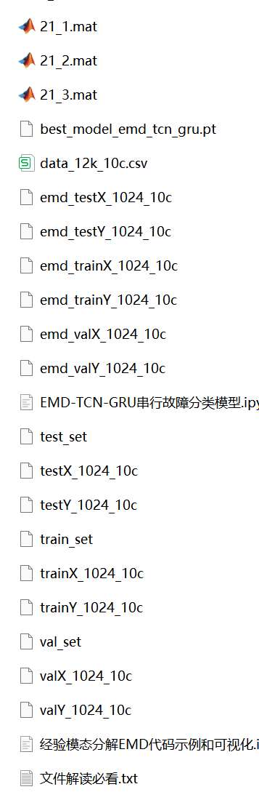
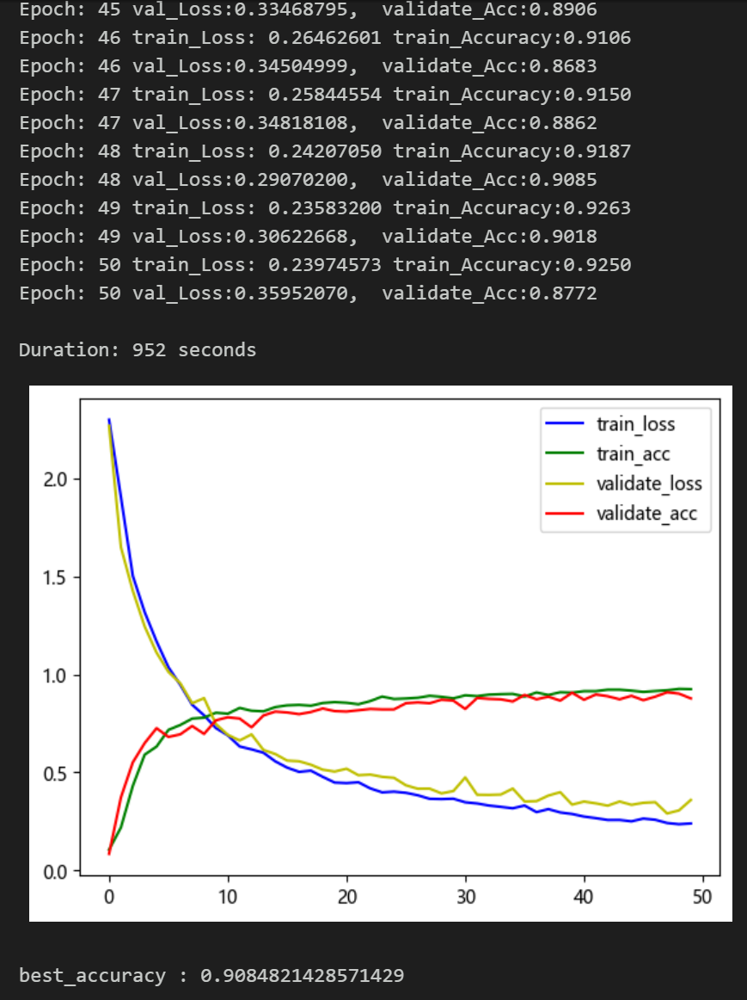

# Bear Fault Diagnosis EMD-TCN-GRU Serial Classification Model

Includes a complete CWRU bearing fault dataset, as well as the generated fault signal dataset, classification data, and label set. All code can be run.
Includes data preprocessing code and EMD-TCN-GRU classification code.
Environment: Python 3.9 PyTorch 1.8 or above.
\n\n\n

## Images

<!-- PAYMENT_BLOCK -->

## Get this dataset

- Payment link (Stripe): [Buy now](https://buy.stripe.com/3cs8yP7sY87d0vu9AB)
- Payment QR code: 

<!-- /PAYMENT_BLOCK -->
